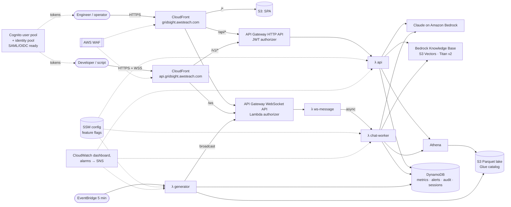

# GridSight AI

**Grid operations intelligence for ERCOT engineers.** GridSight AI is a serverless AWS platform that combines real-time and historical grid awareness, AI-assisted anomaly detection and load forecasting, and a Claude-powered assistant that can query grid data and operating knowledge in natural language. It ships with RBAC, audit trails, REST and WebSocket APIs, and the docs engineers need to extend it.

> All grid data is **synthetic**. A deterministic simulator produces ERCOT-like 5-minute intervals (load, generation mix, frequency, reserves, hub prices, contingencies), so the platform works immediately without live ERCOT feeds. Knowledge-base documents are synthetic training material, not official ERCOT publications.

| | |
|---|---|
| **App** | `https://gridsight.awsteach.com` (prod) · `https://dev.gridsight.awsteach.com` (dev) |
| **API** | `https://api.gridsight.awsteach.com/v1` · WebSocket `wss://api.gridsight.awsteach.com/ws` |
| **Region** | `us-east-1` |
| **IaC** | AWS CDK (TypeScript), 6 stacks per environment |

---

## Contents

1. [What you get](#what-you-get)
2. [Architecture](#architecture)
3. [Repository layout](#repository-layout)
4. [Deploy](#deploy)
5. [Use the application](#use-the-application)
6. [Use the API](#use-the-api)
7. [Extend GridSight](#extend-gridsight)
8. [Operations, security and observability](#operations-security-and-observability)
9. [Cost](#cost)
10. [Clean up](#clean-up)
11. [Troubleshooting](#troubleshooting)

---

## What you get

**Dashboards (React + ECharts)**
- KPI tiles: system load vs forecast, net load, renewable share, frequency, PRC with reserve status, system lambda
- Load vs operational forecast and GridSight's forecast with a P10–P90 band
- Generation mix stacked by fuel (nuclear, coal, hydro, gas, wind, solar, storage, other); storage charging shows below zero
- System frequency (min/mean/max) against the 59.95 / 60.05 Hz alert band
- PRC against the 3,000 MW advisory and 2,500 MW EEA-level thresholds
- LMPs for five trading hubs, weather-zone load and temperature, active contingencies, and a live alert feed
- Live updates over WebSocket every 5 minutes; light and dark themes; a table view on every chart

**AI (Claude on Amazon Bedrock)**
- Streaming assistant (WebSocket) with an agent loop over 7 tools: live snapshot, recent metrics, **SQL on the data lake**, **load forecasting**, **anomaly detection**, **RAG over operating documents** (Bedrock Knowledge Base on S3 Vectors) and alerts
- Natural language → SQL with structured output, guarded and executed on Athena
- Tool traces in the UI (including the SQL the model ran), conversation history, per-turn token usage
- Admin-editable model IDs, effort, prompt profile, tool toggles and feature flags; a fallback model if the primary declines

**Analytics**
- Weather-normalized ridge-regression load forecast with residual-quantile bands and a backtest against seasonal-naive
- Detectors: frequency excursions, low PRC, load-forecast deviation, net-load ramps, robust z-score (median/MAD) on wind ramps and prices, stale-telemetry flatlines, plus contingency events

**Enterprise plumbing**
- Cognito user pool with classroom-friendly self-registration (username + 6-character password, pick your role, no email or verification), SAML/OIDC federation hooks; identity pool mapping groups to IAM roles
- Roles **Viewer < Analyst < Operator < Admin** enforced on every route
- Audit log of AI prompts, tool calls, token usage, SQL, alert workflow, configuration and role changes
- CloudFront + AWS WAF in front of the SPA *and* the APIs; ACM certificates; Route 53 aliases
- CloudWatch dashboard and alarms, structured JSON logs, X-Ray tracing, EMF custom metrics
- Least-privilege IAM per function, Secrets Manager for the origin-verification secret, SSM Parameter Store for versioned runtime config
- Dev and prod environments; prod runs compute in private subnets

---

## Architecture



**Text version:** Two CloudFront distributions (app and API) sit behind one WAF web ACL. The app distribution serves the React SPA from S3 and proxies `/api/*` to the HTTP API (stripping the prefix) and `/ws` to the WebSocket API. The API distribution exposes the same backends at `api.gridsight.awsteach.com` for developers. API Gateway validates Cognito access tokens (JWT authorizer for REST, a Lambda authorizer for WebSocket) and invokes Lambda functions. A scheduled generator writes a synthetic interval every 5 minutes to DynamoDB (hot store) and hourly Parquet files to S3 (lake), runs the anomaly detectors, and broadcasts updates over WebSocket. The AI assistant runs in an async worker Lambda that calls Claude on Bedrock and executes tools against DynamoDB, Athena, the forecaster, the detectors and the Bedrock Knowledge Base, streaming tokens back to the browser.

### CDK stacks (per environment)

| Stack | Contents |
|---|---|
| `GridSight-<env>-Data` | DynamoDB tables (metrics, alerts, audit, sessions, connections), S3 lake + Athena results, Glue database/tables with partition projection, Athena workgroup with a scan limit, SSM config parameter, VPC (prod) |
| `GridSight-<env>-Auth` | Cognito user pool, groups and group IAM roles, app clients (web, CLI), hosted UI domain, identity pool, optional SAML/OIDC IdPs, sign-up and token triggers |
| `GridSight-<env>-Knowledge` | Docs bucket + deployment, S3 vector bucket/index, Bedrock Knowledge Base and data source, ingestion trigger |
| `GridSight-<env>-Api` | All Lambda functions, HTTP API (JWT), WebSocket API, EventBridge schedule, deploy-time backfill trigger, origin-verification secret |
| `GridSight-<env>-Edge` | ACM certificate, WAF web ACL with logging, CloudFront distributions and functions, Route 53 A/AAAA aliases, SPA deployment with runtime `config.json` |
| `GridSight-<env>-Observability` | CloudWatch dashboard, alarms, SNS topic |

Design decisions are recorded in [`docs/adr/`](docs/adr). The data model is in [`docs/data-dictionary.md`](docs/data-dictionary.md).

---

## Repository layout

```
.
├── api/openapi.yaml              # OpenAPI 3 spec (served at /openapi.yaml, rendered on the Developers page)
├── docs/                         # architecture, extending guide, data dictionary, ADRs
├── infra/                        # AWS CDK app (TypeScript)
│   ├── bin/gridsight.ts          #   stack wiring
│   ├── config/environments.ts    #   dev/prod settings and context overrides
│   └── lib/stacks/*.ts           #   Data, Auth, Knowledge, Api, Edge, Observability
├── knowledge/                    # synthetic operational documents indexed for RAG
├── scripts/                      # deploy.sh, smoke-test.sh, create-user.sh
├── sdk/typescript, sdk/python    # client libraries with examples
├── services/                     # Lambda code (TypeScript, ESM, bundled with esbuild)
│   ├── src/data/                 #   synthetic grid model + lake schema
│   ├── src/analytics/            #   forecaster, anomaly detectors
│   ├── src/ai/                   #   agent loop, tools, prompts, chat sessions
│   ├── src/lib/                  #   router, auth, config, repos, Athena, SQL guard, lake writer
│   ├── src/handlers/             #   Lambda entry points
│   └── test/                     #   vitest unit tests
└── web/                          # React + Vite SPA
```

---

## Deploy

### Prerequisites

1. **AWS credentials with administrator-level permissions** for the target account (CloudFormation, IAM, Lambda, API Gateway, DynamoDB, S3, Glue, Athena, Cognito, Bedrock, S3 Vectors, CloudFront, WAF, ACM, Route 53, CloudWatch, SNS, Secrets Manager, SSM, EC2/VPC for prod).
2. **Route 53 public hosted zone for `awsteach.com`** in the same account.
3. **Bedrock model access** in `us-east-1`:
   - Claude: `us.anthropic.claude-opus-4-6-v1` is the default chat model; `us.anthropic.claude-sonnet-4-6` is the SQL model and fallback. Newer models (`anthropic.claude-opus-5-5`, served by Bedrock's Mantle endpoint) work too and can be selected on the Admin page. Request access in the [Bedrock console](https://console.aws.amazon.com/bedrock/home#/modelaccess) if a model isn't open to your account. You can switch models later from **Admin → Feature flags & AI** without redeploying.
   - Embeddings: `amazon.titan-embed-text-v2:0` for the Knowledge Base.
4. Node.js 20+ (22 recommended), npm 10+, AWS CLI v2, `jq` (for the smoke test). Docker is **not** required: Lambdas bundle with local esbuild.

### One command

```bash
./scripts/deploy.sh dev                          # dev:  https://dev.gridsight.awsteach.com
./scripts/deploy.sh prod oncall@example.com      # prod: https://gridsight.awsteach.com (+ optional alarm emails)
```

The script checks permissions, resolves the hosted zone ID, installs dependencies, runs the tests, builds the SPA, bootstraps CDK, and deploys all stacks. First deployment takes about 15 to 25 minutes, mostly for CloudFront and certificate validation. During deployment:

- the **backfill trigger** generates 90 days of Parquet data, 30 days of 5-minute and 90 days of hourly data in DynamoDB, and a week of alert history;
- the **ingestion trigger** indexes the documents in `knowledge/` into the Knowledge Base.

No users or passwords are created by the deploy. Everyone registers their own (see [Use the application](#use-the-application)).

### Manual sequence (equivalent)

```bash
npm ci
npm test
npm run build -w web
cd infra
npx cdk bootstrap aws://<ACCOUNT_ID>/us-east-1
npx cdk deploy --all -c env=dev -c hostedZoneId=<ZONE_ID> --outputs-file cdk-outputs-dev.json
```

`hostedZoneId` is optional; without it CDK looks the zone up by name.

### Configuration knobs (`-c key=value` or `GRIDSIGHT_<KEY>` env vars)

| Key | Purpose |
|---|---|
| `env` | `dev` (default) or `prod` |
| `alarmEmail` | Subscribe an email to the alarm topic |
| `hostedZoneId` | Skip the Route 53 lookup |
| `allowedEmailDomains` | Comma-separated domains allowed to self-register (e.g. `ercot.com`); requires sign-ups to supply an email |
| `samlMetadataUrl`, `samlProviderName` | Enable SAML federation (Entra ID, Okta, ADFS…) |
| `oidcIssuerUrl`, `oidcClientId`, `oidcClientSecretName`, `oidcProviderName` | Enable OIDC federation (secret stored in Secrets Manager) |

Per-environment defaults (hostnames, VPC mode, throttling, WAF limits, log retention, data retention) are in [`infra/config/environments.ts`](infra/config/environments.ts).

**Federation setup:** after deploying, the Auth stack outputs `SamlEntityId` and `SamlAcsUrl`. Register those in your IdP, then redeploy with `-c samlMetadataUrl=…`. The sign-in page shows a "Continue with <provider>" button automatically. Federated users start as Viewer; map IdP groups to roles in a pre-token-generation trigger if needed (see `docs/extending.md`).

### Verify

```bash
./scripts/smoke-test.sh dev
```

The smoke test registers two throwaway users (Viewer and Admin) with random credentials through the same sign-up flow students use, checks that each gets the right role and that the Viewer is blocked from the assistant, and deletes them afterwards. It also checks the public health endpoint, that unauthenticated calls are rejected, grid data, forecast, Athena SQL (and that DDL is rejected), Knowledge Base search and a live Bedrock call.

### Regional notes

Everything deploys to **us-east-1**. That's also a hard requirement for two pieces: ACM certificates used by CloudFront and WAF web ACLs with `CLOUDFRONT` scope must live in us-east-1. Bedrock Knowledge Bases with S3 Vectors and Claude in Amazon Bedrock are available there. Moving to another region requires a separate us-east-1 stack for the certificate and WAF.

---

## Use the application

There are no preset accounts. On the sign-in page choose **Create an account**, then pick:

- a **username** (3–64 letters, digits or `. _ @ + -`; not case-sensitive),
- a **password** of at least 6 characters (no complexity rules),
- a **role**: Viewer, Analyst, Operator or Admin.

The account is confirmed immediately (no email, no verification code) and you're signed straight in. To see how the roles differ, create one account per role, e.g. `jane-viewer`, `jane-analyst`, `jane-operator`, `jane-admin`, and compare them in separate browser profiles or private windows. Admins can also change anyone's role under **Admin → Users & roles** (it takes effect at the user's next sign-in). From a terminal, `./scripts/create-user.sh dev <username> <Role>` does the same thing and prompts for the password.

Accounts live in the Cognito user pool. There's no password reset, because there's no email to send it to: just create a new account, or an instructor can run `create-user.sh` again to set a new password.

> These settings are deliberately low-friction for a classroom. For a real deployment, restore stricter controls in `infra/lib/stacks/auth-stack.ts` (password policy, MFA, email verification) and in `cognito-triggers.ts` (don't let users choose their own role).

| Page | Role | What it does |
|---|---|---|
| **Overview** | Viewer | KPIs, load/forecast, generation mix, frequency, PRC, hub prices, zones, contingencies, open alerts. Pick 6h–30d. Every chart has a table view. |
| **Forecast** | Analyst | 24/48/72 h forecast with P10–P90, backtest MAPE vs seasonal-naive, peak timing |
| **Alerts** | Viewer (Operator to act) | Filter by status/severity; acknowledge or resolve with notes; updates in real time |
| **Data explorer** | Analyst | Ask in English (Claude writes SQL) or write Athena SQL; sample queries; CSV export |
| **AI assistant** | Analyst | Streaming chat with tool traces and history. Also available as a drawer on every page ("Ask GridSight"). |
| **Developers** | Viewer | Endpoints, copy-your-token, curl and SDK snippets, interactive Swagger UI |
| **Admin** | Admin | Feature flags, model and prompt settings, detector thresholds, users and roles, audit log |

Questions worth trying in the assistant:
- *"What's the state of the grid right now? Flag anything unusual."*
- *"Forecast load for the next 24 hours. When's the peak and how confident are you?"*
- *"Which hours last week had the highest system lambda, and what was PRC then?"*
- *"Walk me through the most recent unit trip: frequency nadir, PRC impact, prices."*
- *"What should an operator do when PRC drops below 2,500 MW?"* (RAG)

---

## Use the API

Get a token (CLI app client, `USER_PASSWORD_AUTH`):

```bash
GS_USER=<your username>; read -rsp 'Password: ' PASSWORD; echo
OUT=infra/cdk-outputs-dev.json
CLIENT_ID=$(jq -r '."GridSight-dev-Auth".CliClientId' $OUT)
API=$(jq -r '."GridSight-dev-Edge".ApiUrl' $OUT)
TOKEN=$(aws cognito-idp initiate-auth --region us-east-1 --client-id $CLIENT_ID \
  --auth-flow USER_PASSWORD_AUTH --auth-parameters USERNAME=$GS_USER,PASSWORD="$PASSWORD" \
  --query AuthenticationResult.AccessToken --output text)
```

```bash
curl -s -H "Authorization: Bearer $TOKEN" $API/v1/grid/current | jq '{load_mw, prc: .reserves.prc_mw, status: .derived.reserve_status}'
curl -s -H "Authorization: Bearer $TOKEN" "$API/v1/forecast/load?hours=48" | jq '.backtest'
curl -s -H "Authorization: Bearer $TOKEN" "$API/v1/alerts?status=OPEN" | jq '.alerts[] | {severity, title}'
curl -s -X POST -H "Authorization: Bearer $TOKEN" -H 'content-type: application/json' \
  -d '{"sql":"SELECT dt, max(load_mw) AS peak FROM grid_interval WHERE dt >= '\''2026-10-01'\'' GROUP BY dt ORDER BY dt"}' \
  $API/v1/query/sql | jq '.rows'
curl -s -X POST -H "Authorization: Bearer $TOKEN" -H 'content-type: application/json' \
  -d '{"question":"Average HB_WEST LMP by Central-time hour over the last 7 days"}' $API/v1/ai/sql | jq '{sql, rows: .result.rows[:5]}'
```

**Streaming chat over WebSocket** (`wss://<api-host>/ws?token=<access token>`):

```jsonc
// send
{"action":"chat","requestId":"6f1c…","message":"Why did PRC drop this evening?"}
// receive
{"type":"chat.accepted","requestId":"6f1c…"}
{"type":"chat.tool","status":"running","name":"get_recent_metrics", …}
{"type":"chat.delta","text":"PRC fell from 6.1 GW to …"}
{"type":"chat.done","sessionId":"…","model":"us.anthropic.claude-opus-4-6-v1","usage":{…}}
```

All clients also receive `grid.interval`, `alert.new` and `alert.updated` broadcasts.

- **OpenAPI:** [`api/openapi.yaml`](api/openapi.yaml), also at `/openapi.yaml` and rendered on the Developers page
- **TypeScript SDK:** [`sdk/typescript`](sdk/typescript): typed client, zero dependencies, async-iterator chat streaming
- **Python SDK:** [`sdk/python`](sdk/python): `GridSight.login(...)`, `sql_df()` returns a pandas DataFrame
- **Notebooks:** Analyst+ users can exchange their ID token for IAM credentials through the identity pool and query the lake with Athena directly (read-only, scoped to the GridSight workgroup and database).

---

## Extend GridSight

[`docs/extending.md`](docs/extending.md) has step-by-step recipes. In summary:

| Goal | Where |
|---|---|
| Add an AI tool (e.g. outage scheduler lookup, EMS API) | `services/src/ai/tools.ts` + its name in `AI_TOOLS` (`services/src/lib/config-schema.ts`) |
| Change prompts or add a prompt profile | `services/src/ai/prompts.ts` |
| Swap the forecaster (XGBoost, SageMaker endpoint…) | `services/src/analytics/forecast.ts` (keep `ForecastResult`) |
| Add a detector | `services/src/analytics/anomaly.ts` (pure function, add a unit test) |
| Replace synthetic data with real feeds | Write `GridInterval` records from your ingest into DynamoDB and the lake; disable the generator schedule |
| Add a lake table | `services/src/data/schema.ts` (Glue table, Parquet writer and the NL→SQL prompt all derive from it) |
| Add a REST route | `services/src/handlers/api.ts` (`router.get(path, role, handler)`) + `api/openapi.yaml` |
| Add knowledge documents | Drop Markdown/PDF/HTML into `knowledge/` and redeploy; ingestion re-runs automatically |
| Change model or effort at runtime | Admin page, or `PUT /v1/admin/config` |

### Local development

```bash
npm ci
npm test                                   # services unit tests (generator, forecaster, detectors, SQL guard, authz, Parquet)
npm run typecheck
npm run generate:sample -- --days 7        # synthetic Parquet + events/anomalies JSON, no AWS needed
npm run pull-config -w web -- https://dev.gridsight.awsteach.com
npm run dev -w web                         # http://localhost:5173 against the deployed dev API
(cd infra && npx cdk diff -c env=dev)     # preview infrastructure changes
```

---

## Operations, security and observability

**Security controls**
- WAF: Amazon IP reputation, AWS common rule set, known bad inputs, per-IP rate limit (2,000 / 5 min) and a tighter limit on `/v1/ai/*` (300 / 5 min). WAF logs redact `Authorization` and query strings, which carry WebSocket tokens.
- Every API request needs a valid Cognito access token, except `/v1/health`. Roles are checked in the router; WebSocket chat checks the role stored at connect time.
- In prod, API Gateway rejects requests that don't carry CloudFront's origin-verification header (secret in Secrets Manager), so WAF can't be bypassed through execute-api URLs.
- SQL from users and the model goes through a guard (single `SELECT`/`WITH`, no comments, allow-listed tables, enforced `LIMIT`). IAM restricts Athena, Glue and S3 to the GridSight database and lake, and the workgroup enforces a 1 GB per-query scan cutoff.
- Strict CSP, HSTS, `X-Frame-Options: DENY` and other security headers on all responses. TLS 1.2+.
- Each function's IAM role grants only the tables, buckets, actions and resources it uses.
- The audit table is retained even when a dev stack is destroyed. Prod tables have point-in-time recovery and deletion protection.

**Observability**
- CloudWatch dashboard `GridSight-<env>`: API traffic, errors and latency; CloudFront 5xx; AI requests, errors, tokens and latency; data pipeline freshness; Athena bytes scanned; Lambda errors, duration and throttles; WAF allowed vs blocked; top routes from access logs.
- Alarms (SNS): API 5xx, stale data pipeline, generator errors, AI errors, AI token spike (cost guardrail), DynamoDB throttles, WAF block spike.
- Structured JSON logs (Powertools) with request IDs; X-Ray active tracing on all functions; HTTP API access logs in JSON.

---

## Cost

Estimated monthly cost at demo scale, us-east-1 (excluding Bedrock model usage):

| Item | dev | prod | Notes |
|---|---|---|---|
| AWS WAF | ~$10 | ~$10 | $5 web ACL + $1/rule group/rule + $0.60 per million requests |
| CloudWatch (dashboard, alarms, logs) | ~$5 | ~$8 | Log retention 14 d (dev) / 90 d (prod) |
| NAT gateway | — | ~$33 + data | Prod only (private subnets). See ADR-0003. |
| Lambda | <$2 | <$3 | Generator runs every 5 min; everything else is request-driven |
| DynamoDB on-demand, S3, Athena, Glue | <$3 | <$5 | Small data; partition projection keeps scans cheap |
| CloudFront, Route 53 queries, Secrets Manager, Cognito (Essentials free tier) | ~$1 | ~$2 | |
| Bedrock Knowledge Base (S3 Vectors + Titan embeddings) | <$1 | <$1 | No always-on vector cluster (ADR-0002) |
| **Baseline** | **~$20/mo** | **~$60/mo** | |

**Bedrock (usage-based) is the main variable cost.** A typical assistant turn uses roughly 10k–30k input tokens (system prompt, schema and tool results) and 1k–3k output tokens. Prompt caching is enabled, so the stable system prompt and tool definitions are billed at cache-read rates on later turns. Watch the *AI tokens* widget and the token-spike alarm. To cut cost, switch the chat model to a Sonnet or Haiku model, lower **effort**, reduce **max tool iterations**, or disable the assistant with the `aiChat` flag. Check current [Bedrock pricing](https://aws.amazon.com/bedrock/pricing/).

Other levers: set `network.mode: 'none'` in prod to drop the NAT gateway, shorten log retention, or remove the generator schedule when nobody is using a dev environment.

---

## Clean up

```bash
cd infra
npx cdk destroy --all -c env=dev
```

Dev deletes its buckets and tables, **except the audit table**, which is always retained. Delete it manually if you're sure:

```bash
aws dynamodb list-tables --query "TableNames[?contains(@, 'GridSight-dev-Data-Audit')]"
aws dynamodb delete-table --table-name <name>
```

Prod retains its data stores (DynamoDB with deletion protection, lake bucket, user pool, Knowledge Base vectors, CloudFront logs). To fully remove prod, disable deletion protection on the tables and user pool, destroy the stacks, then empty and delete the retained buckets. Route 53 records and the ACM certificate are removed with the Edge stack. The hosted zone itself is never modified beyond the GridSight records.

---

## Troubleshooting

| Symptom | Likely cause / fix |
|---|---|
| Deploy stuck on certificate validation | The hosted zone must be public and authoritative for `awsteach.com`; check NS delegation. |
| Assistant says "AI assistant is disabled" | `features.aiChat` or `ai.enabled` is off (Admin → Feature flags). |
| Assistant errors with access denied | Claude model access isn't enabled for the configured model ID. Enable it in Bedrock, or switch to a model your account can use on the Admin page (`us.anthropic.claude-sonnet-4-6` is widely available). |
| Knowledge search returns nothing | The ingestion job may still be running, or Titan Embeddings v2 access isn't enabled. Check the Knowledge Base's data source sync status in the Bedrock console. |
| Dashboards empty right after deploy | The backfill trigger runs during deployment; check the `Backfill` function logs. The generator fills gaps within 5 minutes. |
| "Live" indicator stays Offline | Corporate proxies sometimes block WebSockets. The app falls back to the direct API Gateway URL in dev; REST still works and dashboards poll every minute. |
| Local dev gets CORS errors | Use `npm run pull-config -w web`, which points the SPA at the API domain; `http://localhost:5173` is allowed by the HTTP API CORS config. |
| Admin config changes reverted after a deploy | The SSM parameter is overwritten when `DEFAULT_CONFIG` in code changes. Change defaults in `services/src/lib/config-schema.ts` for durable changes. |

Known limitations: WebSocket broadcasts scan the connections table (fine for hundreds of clients; see ADR-0006 for the scaling path), and the synthetic model simplifies physics and markets (see ADR-0004).
